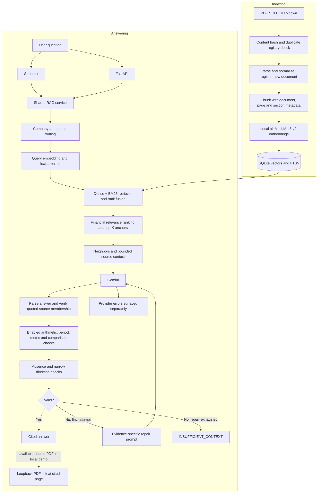

# Architecture

Updated 2026-10-28. The diagram shows implemented application paths, not proof of
deployment. Streamlit and
FastAPI independently call the shared service.

## Runtime defaults and configurable features

- Default index: fixed-token, 200 whitespace-delimited tokens, overlap 40.
- Section-aware chunking is a separate comparison index, not a sequential step.
- API/demo defaults use three anchors. Generation selects at most nine chunks.
- Groq is an alternative provider, not an additional LLM stage.
- Evidence mode adds structured quote validation and one bounded repair attempt.
  Plain-text citation processing is the default. Verbatim quote membership is
  not semantic entailment.
- Statement/row scoring and financial-concept scoring are opt-in. The measured
  five-anchor profile is not automatically enabled in the demo.
- Cross-encoder reranking exists but is disabled by default after its experiment.
- PDF links use a local loopback server, normally port 8502; remote authenticated
  delivery is not implemented. Provider failures surface separately from abstention.

## Evaluation alongside the application

Expected answers/pages are scoring references, never supplied to the answer
model or query-time retriever. The bounded sensitivity experiment selects its
reduced corpus by expected filenames, then uses inferred query routing; it is
not a full-corpus routing benchmark. Reports distinguish filing recall, page recall, bounded
generation-context coverage, answer accuracy, citation overlap and abstention.
The latest 50-case collection is complete and agent-reviewed: 42 supported,
six unsuccessful and two unresolved definition cases. Final answer accuracy is
not settled. Citation-location matching is 36/50 (72%), filing recall 50/50 and
labelled-page recall 47/49. This is a tuned development set, not held-out testing.

## Implemented defaults versus measured profile

| Setting | Application default | Latest 50-case profile |
| --- | --- | --- |
| Chunking / anchors | Fixed-token 200/40, K=3 | Fixed-token 200/40, K=5 |
| Generation mode | Text | Evidence validation and bounded repair |
| Statement ranking | Off | On |
| Financial-intent ranking | Off | On, with operand/numeric coverage |
| Cross-encoder | Off | Off |

The [report](experiment-report.md) records fixed-token 9/11 answer/citation
accuracy and section-aware 7/11 after scorer correction. The
[bounded sensitivity study](chunk-sensitivity-results.md) supports 200/40 within
its limited protocol. These results do not change runtime defaults.

Implemented capabilities include ingestion, chunking, hybrid retrieval, evidence
ranking/repair, cited generation, service/API, PDF links and evaluation. Their
implementation history is recorded in [IMPROVEMENTS.md](../IMPROVEMENTS.md).

No table-aware corpus index, agentic layer, fine-tuning, distributed database,
cloud deployment, authentication or background queue is shown as active.
Historical experiment settings are preserved in the evaluation report.
